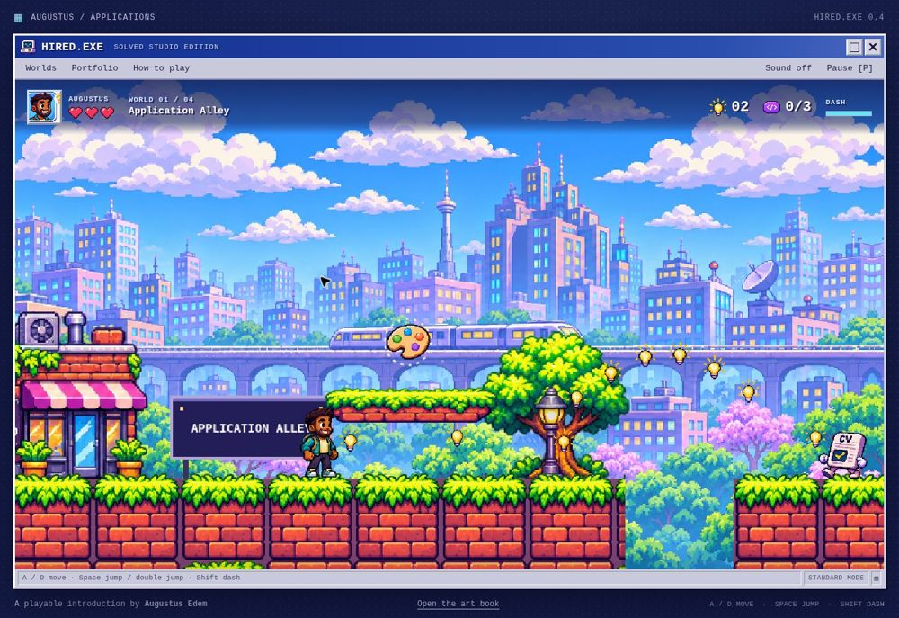
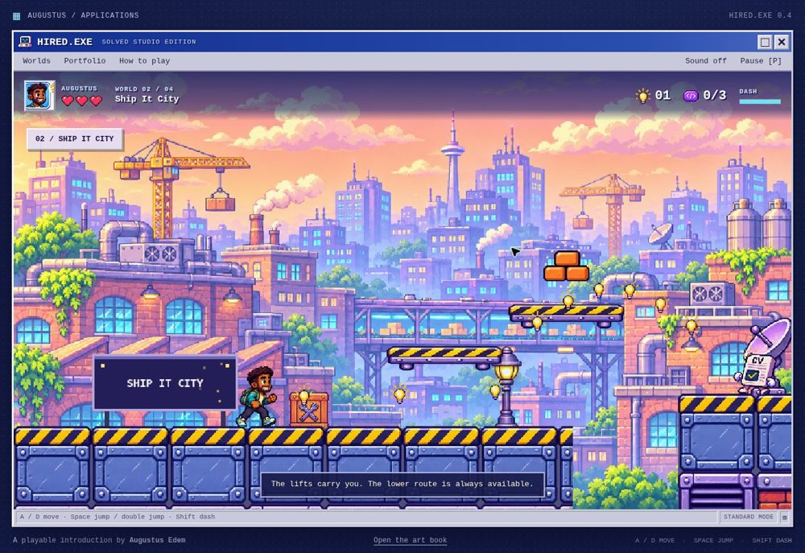
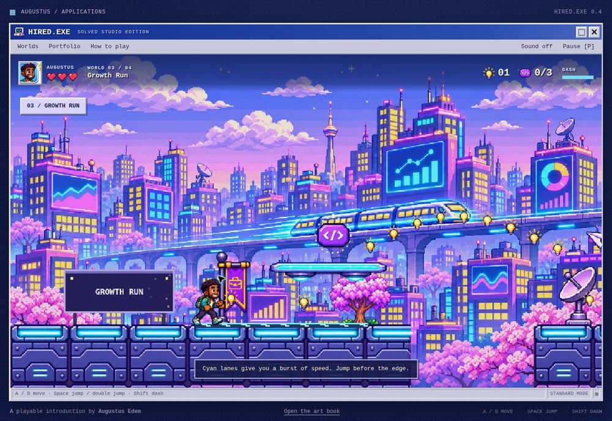
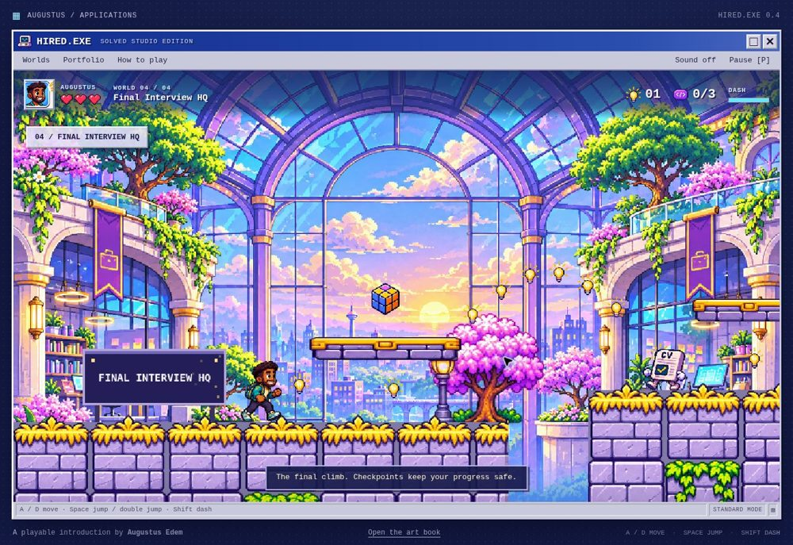

# HIRE.EXE playtest

The four pictures below are browser captures of the playable game. The original concept illustrations are under `references/`. The game uses the approved 18-frame hero atlas, three animated enemy families, four environment plates, separate terrain and props, and independently defined collision surfaces.

| Application Alley | Ship It City |
| --- | --- |
|  |  |
| **Growth Run** | **Final Interview HQ** |
|  |  |

## Observed browser route

The Chrome playthrough opened the title, skipped to the portfolio, returned to the world directory, paused, opened help, restarted, then played through all four worlds in standard mode. It used keyboard events at 1100 × 760 and touch-pointer events on the on-screen buttons at 390 × 844. The route controller reads the current position and encounter phase. It directs the DOM controls and never writes positions, boss health, saves or completion flags to win.

| World | Desktop and portrait route result | In-game time on those runs |
| --- | --- | --- |
| Application Alley | Both terminals activated, 32 ideas, CV Filter defeated | 22.3 s |
| Ship It City | Both terminals activated, 32 ideas, three sign-offs filed | 13.6 s |
| Growth Run | Both terminals activated, 25 ideas, one retry, Algorithm defeated | 24.4 s |
| Final Interview HQ | Both terminals activated, 11 ideas, interview reached | 10.6 s |

Both routes completed the three conversation topics, returned from the portfolio to the personalised ending, checked that the email draft included the chosen project, then reloaded and verified all four saved results. Sound on/off was exercised separately during live play. The timings are an automated route through the game. A first-time recruiter's completion time has yet to be measured.

## Independent browser runs

The [Playtest workflow](https://github.com/EmotiveImpact/HIRED.EXE/actions/workflows/playtest.yml) runs Chromium desktop, Chromium with a Pixel 7 profile and WebKit with an iPhone 13 profile. Each job checks the native entry controls, runs the campaign and opens both standalone bundles. Each mobile job checks portrait and landscape controls. Android additionally sends simultaneous movement and dash contacts followed by cancellation. Each job uploads its screenshots and a text result to the workflow run. The current PR links the run for the reviewed revision.

These profiles emulate phones. Physical iOS and Android handsets and a human first-play pacing study remain outside the observed coverage.

## Reproduce

Run the four commands in the repository README for simulation, build, offline inventory and packaging. The 39 simulation tests include jumps at 30/60/120 Hz, moving and one-way platforms, invulnerability, checkpoint restoration, all twelve reachable skill tokens and four hidden notes, normal and relaxed routes, the Feed's chase on a wide and a narrow view, signs and save points that stay clear of each other, old saves that survive a tidied level, and the final host's non-combat interaction. The offline check compares embedded bytes against the source files, parses inline scripts and checks the static links.

For manual input-driven replay, serve the repository, visit `/tests/playthrough.html`, choose a viewport and press **Run four worlds**. Use a separate test origin or private window. For the full CI checks install Python Playwright 1.55.0 and its Chromium and WebKit browsers, then run `python tests/browser.py desktop`, `python tests/browser.py android` and `python tests/browser.py iphone` after building. Each command uses a disposable browser context.
